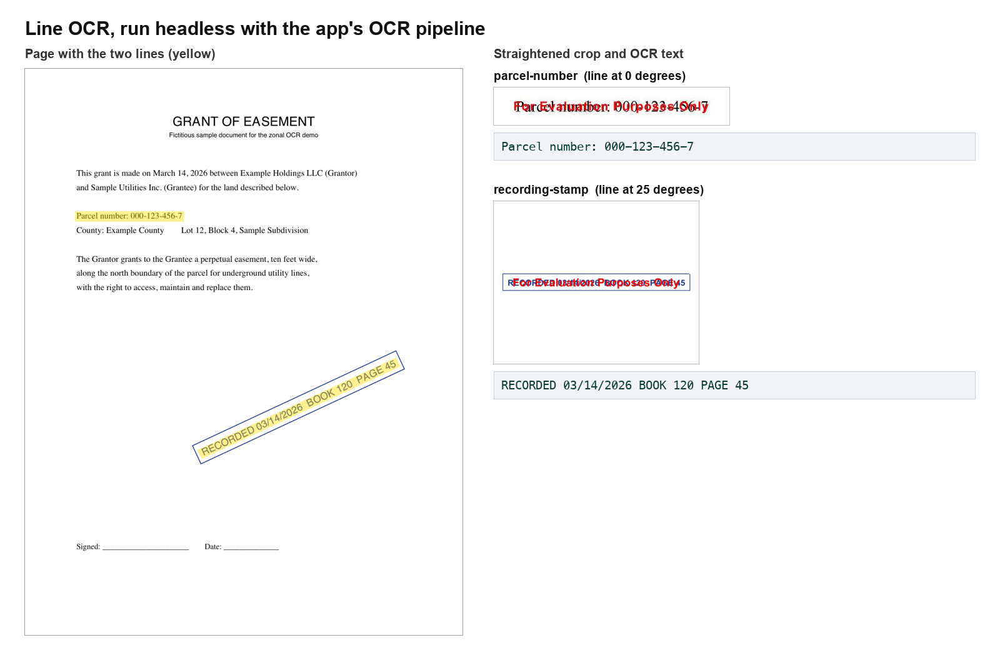

# Nutrient Zonal OCR Viewer

A Nutrient.io demo of a WPF document viewer, built on the GdPicture.NET viewer controls, in which you mark a zone with a freehand highlighter or a line and get the OCR text of that zone, even when the text is slanted.



*Not a screenshot of the WPF app, which runs on Windows only. The same OCR pipeline (`ZonalOcrViewer/OcrPipeline.cs`) was run on macOS with `tools/OcrPreview` on the generated sample. The crops carry the evaluation watermark, which GdPicture stamps when the image is saved, after OCR.*

1. **Viewer.** The app opens PDFs, images and Office documents in the GdPicture `GdViewer`, with thumbnails, bookmarks and the annotation toolbar of the GdPicture annotations sample.
2. **Mark a zone.** Two OCR tools are in the toolbar:
   - **Freehand OCR**: draw a freehand highlighter stroke over the text.
   - **Line OCR**: draw a line along the text, by dragging or with two clicks.
3. **Crop.** The zone is converted from viewer coordinates to page pixels, padded by 30 pixels and copied from the viewer with `CopyRegionToGdPictureImage`. The Windows display scale is applied to rendered documents (PDF, Office) but not to raster images, which are shown at their native resolution.
4. **Straighten.** For lines, the crop is rotated so the line becomes horizontal; lines within 15 degrees of horizontal are not rotated. Diagonal freehand strokes are rotated the same way and trimmed to the band around the stroke; other strokes get a coarse rotation (0, 90, 180 or 270 degrees) from the drawing direction.
5. **OCR.** A copy of the crop is upscaled when small, sharpened and converted to black and white, then read with `GdPictureOCR` (Latin dictionary, accuracy mode, skew and orientation detection).
6. **Result.** A window shows the crop next to the recognized text. The highlighter mark is removed and the tool stays active for the next zone.

Everything runs locally. No cloud service is called.

## Prerequisites

- Windows 10 or 11 to run the app (WPF). It builds on macOS and Linux with `-p:EnableWindowsTargeting=true`, but cannot run there.
- .NET SDK 8 or later. The headless preview tool targets .NET 10.
- The OCR dictionary `lat.traineddata`. It is not stored in this repository. Get it from one of these sources:
  - the [GdPicture.Resources](https://www.nuget.org/packages/GdPicture.Resources) NuGet package (`runtimes/any/native/lat.traineddata`); the app finds it in the local NuGet cache (`%USERPROFILE%\.nuget\packages\gdpicture.resources`) if it is there;
  - <https://github.com/tesseract-ocr/tessdata_fast/raw/main/lat.traineddata>.

  Put it in an `ocr` folder next to `ZonalOcrViewer.exe`, or set `OCR_RESOURCES_PATH` to the folder that contains it.
- To regenerate the sample: Python 3 with `reportlab`.

The app uses GdPicture 14.3, which ships the WPF viewer controls in the `GdPicture` package. From 14.4 they are in the separate `GdPicture.WPF` package.

## Environment variables

Keys are only read from environment variables, never from code. Start from `.env.example`.

| Variable | Purpose | Default |
|---|---|---|
| `GDPICTURE_LICENSE_KEY` | GdPicture.NET license key | empty = evaluation mode |
| `OCR_RESOURCES_PATH` | Folder that contains `lat.traineddata` | `ocr` next to the app, then the GdPicture.Resources package in the NuGet cache |

In evaluation mode the viewer shows a watermark, and the crop shown in the result window carries one. OCR runs before the crop is saved, so the text is not affected.

## Build and run

On Windows, in PowerShell, from the repository root:

```powershell
$env:GDPICTURE_LICENSE_KEY = ""
```

```powershell
dotnet run --project ZonalOcrViewer
```

To check that it builds on macOS or Linux:

```bash
dotnet build ZonalOcrViewer -p:EnableWindowsTargeting=true
```

## Using the app

1. **File > Open** (Ctrl+O) and pick a document, for example `samples/recorded-document.pdf`.
2. Click **Freehand OCR** and draw over a word or a line of text. Release the mouse: the result window opens with the crop and the text.
3. Click **Line OCR** and draw a line along the text you want, also slanted text such as a stamp:
   - drag from the start to the end of the text, or
   - click at the start, then click at the end.
4. Click the active button again to leave the mode. The two OCR tools cannot be active at the same time.

The other annotation tools come from the GdPicture annotations sample. **File > Save**, the embedded image tool and the rubber stamp tool are not implemented.

## Headless preview

`tools/OcrPreview` compiles `ZonalOcrViewer/OcrPipeline.cs` against the cross-platform GdPicture.API package and runs Line OCR without the viewer: it renders page 1 at 150 DPI, crops around each line of `samples/lines.json`, straightens the crop and runs OCR. It runs on Windows, macOS and Linux.

```bash
dotnet run --project tools/OcrPreview
```

```text
parcel-number: angle 0,0 deg, crop 377x60 px -> "Parcel number: 000-123-456-7"
recording-stamp: angle -25,0 deg, crop 638x330 px -> "RECORDED 03/14/2026 BOOK 120 PAGE 45"
```

The crops and `results.json` are written to `output/`.

## Sample

`samples/recorded-document.pdf` is a fictitious one-page document with a slanted recording stamp. `samples/lines.json` holds the two lines read by the preview tool, in inches from the top-left corner. Both are generated by `samples/generate_sample.py`.

```bash
python3 samples/generate_sample.py
```

## Project layout

| Path | Content |
|---|---|
| `ZonalOcrViewer/MainWindow.xaml(.cs)` | Viewer, toolbar, OCR modes, mouse handling, result window |
| `ZonalOcrViewer/FreehandOcrService.cs` | Crop and rotation for freehand strokes |
| `ZonalOcrViewer/LineOcrService.cs` | Crop for lines, display scale handling |
| `ZonalOcrViewer/OcrPipeline.cs` | Crop rectangle, straightening, image clean-up and OCR (no WPF dependency) |
| `ZonalOcrViewer/CustomCommands.cs` | Menu commands and shortcuts |
| `ZonalOcrViewer/resources` | Toolbar icons |
| `tools/OcrPreview` | Headless run of the OCR pipeline |
| `samples/` | Sample document, lines and generator |
